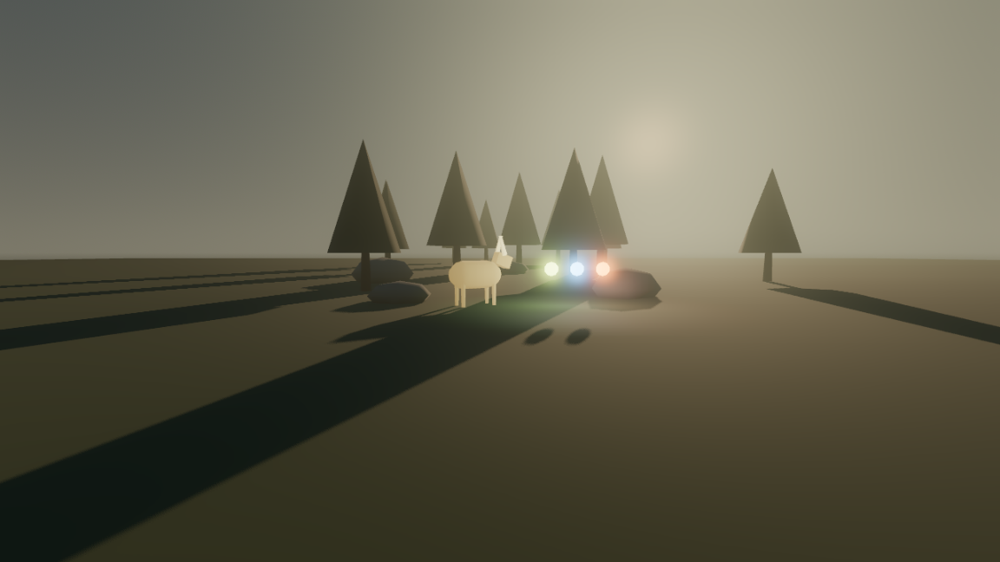

# Sumoner World - Art Style Guide
Version: **0.1** (M0-09) · Date: 2026-10-19 · Owners: Sr Game Artist (look) + Technical Artist (budgets, pipeline) · Status: **Delivered, review pending (stakeholder)**
Rules: R22, R24, R47 · Related: DEC-002 Part B ("Mythic Low-Poly"), TDD v0.1 §1 (budgets), AI Bible v0.1 §6.2 (emotes), M0-08 (IP guardrails)

> Every shipped asset must pass the checklist in §9. Budgets in §6 are hard limits unless a waiver is logged (enforcement doc §5).

*Lighting test scene `source/project-sumoner-worl/scenes/dev/LightingTest.tscn` (Godot 4.7.2, Forward+, rendered on the dev PC). Placeholder shapes only. It shows the value structure: low, foggy environment → lighter creature → magic as the brightest element, with a backlit low sun for depth.*

---

## 1. Style pillars
1. **Silhouette first.** Shapes are simple, clear and readable from far away. If it needs texture detail to be understood, the shape is wrong.
2. **Light tells the mood.** Geometry stays simple; fog, sun angle, weather and glow make it beautiful (Valheim's lesson). Every biome is defined by its light before its props.
3. **Mythic, not cute.** Creatures come from folklore and myth: strange, dignified, sometimes unsettling. No mascots (DEC-002, market positioning).
4. **Magic is the brightest thing on screen.** Nothing in the environment may compete with spell light or summoning sigils.
5. **Emotion through motion.** A creature's memory and mood are read from posture and movement (Pillar 1). Animation budget beats texture budget.

## 2. Value and colour structure
| Layer | Value (brightness) | Saturation | Notes |
|---|---|---|---|
| Sky and distant fog | high, soft | low | gives depth; fog hides streaming edges (TDD §5.2) |
| Environment (ground, trees, rocks) | **low to mid** | **low** (≤ 40% HSV) | backdrop; never pure black |
| Creatures | **one step above the environment** | low–mid, one accent colour | must separate from the ground at 50 m |
| Player and gear | like creatures | mid | |
| Magic, sigils, bond effects | **highest** (HDR emission ≥ 4, glow) | high | the only fully saturated colours |

### 2.1 Biome palettes (v0.1; values used in the lighting test are marked ✓)
| Biome | Ground | Foliage | Rock | Fog / sky | Sun | Mood |
|---|---|---|---|---|---|---|
| **Hollow Forest** | `#3E4A2F` ✓ | `#2B3A2A` ✓ | `#5E5F5A` ✓ | fog `#8FA3A0` ✓, sky `#3F5A73`→`#B9B7A3` ✓ | `#FFD9A8` low, backlit ✓ | quiet, old, watched |
| **Wind Highlands** | `#6B6A4F` | `#5C6B45` | `#7C7A75` | fog `#B8C4CC`, sky `#5D7FA0` | `#FFF1D6` high, hard | open, exposed, cold |
| **Drowned Marsh** | `#3A3A2C` | `#4A5233` | `#4F4D47` | fog `#9AA38A` (thick), sky `#6E7466` | `#E8D9A0` diffuse | humid, rotten, hidden things |
| **Spirit area** (hidden) | `#2A2E3A` | `#3A4B5C` | `#525A6B` | fog `#6F8FA8`, glow motes | moonlight `#BFD4FF` | sacred, unreal |

### 2.2 Magic school colours (from DEC-002)
| School | Core colour | Shape language (for colour-blind readability) |
|---|---|---|
| **Primal** | `#B8E05A` ✓ | organic: leaves, spirals, roots growing |
| **Storm** | `#6FB7FF` ✓ | sharp: zigzags, sparks, straight fast lines |
| **Ember** | `#FF7A2E` ✓ | rising: embers, flicker, upward drift |

Primal and Ember can look alike to players with red–green colour blindness, so **every school must be recognisable by shape and motion alone**. Check all VFX with a deuteranopia/protanopia filter before review.

## 3. Creature design

### 3.1 Sources
Folklore and myth, mainly **northern European** (Baltic, Finno-Ugric, Nordic) forest and marsh spirits, beasts and omens. This sets us apart from Palworld/Pokémon (mascots) and from Valheim (Norse warriors and gods). Each species gets a one-line myth note in its design sheet.

### 3.2 Silhouette rules
1. **Readable at 50 m:** a solid black silhouette **64 px tall** must identify the species and its ecological role. Every species sheet includes this test.
2. **Max 3 major shapes** (e.g. body, neck/head, one signature feature) plus legs.
3. **One signature feature per species** (antlers, frill, tail shape, back ridge) that is visible in silhouette and is used for its emotes.
4. **Adult proportions:** head-to-body ratio no more than 1 : 3; small eyes; no chibi or "baby" proportions, even for small creatures.
5. **No ball, sphere or capsule-container motifs** in creature or summoning designs (M0-08 IP guardrails).
6. Species of the same role must still differ in silhouette (no recolours as separate species; DEC-002 "deep over broad").

### 3.3 Role shape language
| Role | Shape | Posture | Accent colour family |
|---|---|---|---|
| Predator | angular, forward-leaning, long low body | head low, eyes forward | rust / ochre-red |
| Grazer | rounded, horizontal, sturdy | head up, ears wide, alert | muted green-brown, cream |
| Scavenger | hunched, uneven, long limbs | sideways, opportunistic | desaturated violet-grey |
| Spirit | vertical, floating or thin, partly translucent | still, then sudden | pale cyan-teal glow |
| Apex | huge, layered silhouette, crown-like feature | slow, deliberate | deep tone + gold/ember accent |

### 3.4 Body types (shared rigs, DEC-002)
**Quadruped, avian, serpentine, biped.** Every species uses one of these four rigs (≤ 60 deform bones). Unique parts (antlers, frills) are extra bones on top of the shared skeleton, so shared animation clips still work.

## 4. Emotes and body language (contract with AI Bible §6.2)
Each body type must perform all six emotes, readable at **30 m** without UI:

| Emote | Quadruped key pose | Avian | Serpentine | Biped |
|---|---|---|---|---|
| **Trust** | head level, slow tail, approaches, turns side-on | feathers flat, hops closer | loose coils, head low | open stance, faces you |
| **Fear** | body low, weight back, tail tucked, keeps distance | feathers tight, ready to fly | coils tight, head pulled back | crouched, arms in |
| **Grudge** | stare, head low, signature feature raised, blocks path | wings half-open, stares | head raised high, sways | squared shoulders, slow pacing |
| **Curiosity** | head tilt, circles, sniffs | head bobs, sidesteps closer | tongue/feelers, slow approach | leans in, head tilt |
| **Affection** | nuzzles, leans on player, follows close | lands near, preens | wraps loosely near | stands close, mirrors you |
| **Grief** | slow walk, head very low, returns to the place, calls | silent, perched still | motionless, curled | kneels, still |

Animation priority (per species): idle → locomotion → the six emotes → combat. Emotes come **before** extra attack variations.

**M1 placeholders (M1-21b):** the grazer (mossback: large and round, with a moss crest as its signature feature) and the predator (bogfox: lean and long-tailed, with ears as its signature feature) are built from low-poly primitives with the pivots real models will keep (body, head, tail, legs, signature). `QuadrupedEmotePresenter` poses them as in the table above, exaggerated so the poses read at a distance:
- **Fear:** body very low, nose up, tail tucked, trembling.
- **Grudge:** head low, crest standing tall (the predator's ears lie flat), tail stiff.
- **Curiosity:** head high with a slow tilt, sniffing bob.
- **Affection:** nuzzling bob, fast tail wag.
- **Grief:** head almost on the ground, tail hanging, heavy steps.
- **Trust:** head level and tail up with a slow wag. Idle keeps the head down, grazing.

Screenshots at 12 m and 30 m (`--showcase=grazer|predator --showcase-distance=N`) are in `m1-21_emotes/`. At 12 m every pose is distinct. At 30 m the creatures are about 80 px wide at 1080p, and the silhouettes still separate Fear (low), Grudge (spiky), Curiosity (head up) and Grief (head down). Trust against idle, and Affection, rely on tail and head motion, which still images do not show. Whether players read them is measured in the M1-23 "Memory Grove" playtest.

## 5. Environment
- **Modular kits** snapped to a **1 m grid** (structures) and **0.25 m** (props). Pivot at the base, +Y up, 1 unit = 1 m.
- Trees and rocks: 3–5 variants per type plus random rotation/scale (seeded scatter, TDD §5.1).
- Faceted, flat-shaded look: hard edges kept; normals not smoothed across large faces.
- Ground uses the terrain shader with 4–6 palette layers per biome; no photo textures.

## 6. Technical budgets (aligned with TDD §1)
### 6.1 Geometry and LOD
| Asset | LOD0 tris | LOD1 | LOD2 | LOD3 / far |
|---|---|---|---|---|
| Creature (standard) | **1,500–4,000** | 50% | 25% | ≤ 300 or impostor |
| Creature (apex / boss) | 8,000–12,000 | 50% | 25% | ≤ 800 |
| Player character + gear | ≤ 6,000 | 50% | 25% | ≤ 400 |
| Tree | 800–2,500 | 50% | 20% | impostor |
| Rock / prop | 100–800 | 50% | — | culled |
| Building piece | 100–600 | 50% | — | culled |

LOD switch distances (starting values, tuned in the M1 benchmark): **LOD1 30 m, LOD2 80 m, LOD3 200 m**, matching AI LOD rings and the client streaming rings (TDD §5.2).

### 6.2 Scene limits (recommended spec, 1080p)
| Item | Limit |
|---|---|
| Animated creatures in view | ≤ 60 (TDD §1.1) |
| Draw calls | ≤ 2,500 |
| Visible triangles | ≤ 2.5 M |
| Shadow-casting omni/spot lights in view | ≤ 4 (magic lights cast no shadows by default) |
| Volumetric fog | on all presets; lower resolution on Low |

### 6.3 Textures and materials
- **Palette atlases 256–512 px** per biome and per creature body type; no per-asset unique textures except heroes/apex (≤ 1024 px).
- ≤ 2 materials per creature, ≤ 1 per prop.
- VRAM targets follow TDD §1.2 (≤ 4.5 GB on minimum spec).

### 6.4 Shaders (shared set only, R47)
| Shader | Use |
|---|---|
| `terrain_palette` | terrain layers |
| `foliage_wind` | trees, grass, cloth-like plants (vertex wind) |
| `creature_rim` | all creatures: palette albedo + rim light + mood tint (driven by emote) |
| `magic_emissive` | spells, sigils, bond effects (HDR emission, school colour) |
| `water_simple` | marsh and rivers (added in M2) |

A new shader needs a Technical Artist review and a row in the system registry.

## 7. Pipeline
- **Blender** (4.x LTS) → **glTF 2.0 (`.glb`)** → Godot import presets (versioned in the repo).
- Naming: `cr_<species>_<part>` (creatures), `env_<biome>_<type>_<nn>` (environment), `fx_<school>_<name>` (VFX), `rig_<bodytype>`, `anim_<bodytype>_<action>`. Lowercase snake_case files (ADR-001 naming for resources).
- Folders: `source/project-sumoner-worl/assets/models/{creatures,environment,characters}`, `assets/shaders`, `assets/vfx`.
- LODs are generated by Godot's mesh LOD on import, then checked by eye; hand-made LODs only where auto LOD breaks the silhouette.

## 8. Generative AI and references
- **No generative-AI art in shipped assets** (DEC-002). Concept exploration with AI tools is allowed only for internal reference and must be logged in the PR.
- **Mood boards** live in `documentation/art/concepts/` and contain links or licensed images only, for internal use. Reference directions: Valheim (light and fog over simple shapes), Shadow of the Colossus (mythic scale and silence), Rain World (creature behaviour readability), The Long Dark (painterly sky and weather), northern European folklore illustration (creature sources).

## 9. Asset review checklist (every asset PR)
- [ ] Silhouette test passed (64 px black silhouette, §3.2) - creatures only
- [ ] Within tri, LOD, texture and material budgets (§6)
- [ ] Uses palette atlas and a shared shader (§6.3–6.4)
- [ ] Correct scale, pivot and naming (§5, §7)
- [ ] All six emotes readable at 30 m - creatures only (§4)
- [ ] VFX readable with a colour-blind filter (§2.2)
- [ ] No IP-risk motifs (ball/capsule containers, Pokémon-like proportions) (§3.2, M0-08)
- [ ] No generative-AI content in the shipped files (§8)

## 10. Lighting test scene
`scenes/dev/LightingTest.tscn`: WorldEnvironment (procedural sky, **AgX** tonemapper, SSAO, glow with HDR threshold 1.2, volumetric fog density 0.012 with forward scattering 0.6), one low backlit sun with shadows (150 m), placeholder conifers, rocks, a grazer creature using a rim-light material, and three emissive orbs for Primal, Storm and Ember. Open it in the editor and press F6 to view it. It is the reference for tuning the Hollow Forest biome and for checking that magic stays the brightest element.

## 11. Open items
1. Mood boards collected by hand (stakeholder or artist) in `documentation/art/concepts/`.
2. First real creature (grazer) model + six emotes for the M1 USP playtest "Memory Grove" (M0-07).
3. Tune the LOD distances and the fog cost on Low with the M1 benchmark (B1, B4).

## Changelog
- **0.1 (2026-10-19):** First version. Style pillars, value structure, biome and magic palettes, creature silhouette and role rules, emote pose table, budgets aligned with the TDD, pipeline, review checklist, lighting test scene.
