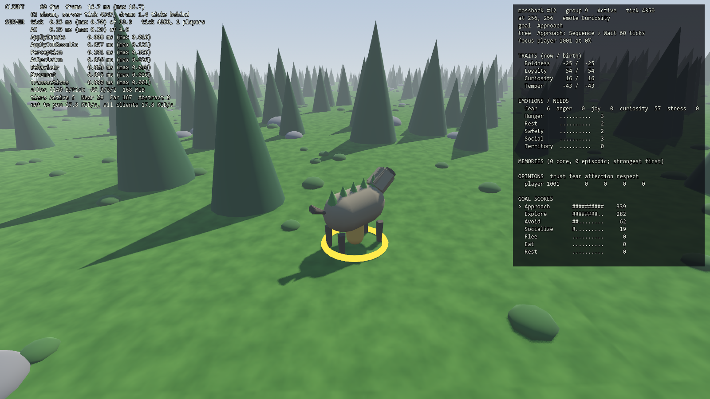

# Dev tools: dev overlay and AI Inspector (M1-22)



## Start
- **Server:** `--dev-tools` or the environment variable `SW_DEV_TOOLS`. The Docker dev server (`docker-compose.dev.yml`) sets it.
  Never turn it on for a public server: any connected client can then read hidden creature minds.
- **Client:** the tools are available in debug builds (the editor binary) and with `--dev-tools`. With `--dev-tools` the overlay
  is shown at start.

```
Godot --path project-sumoner-worl -- --connect=127.0.0.1:7777 --dev-tools
```

A server without dev tools ignores requests and logs `dev.refused`. The overlay then shows "no dev metrics".

## Controls
| Key | Does |
|---|---|
| F3 | Dev overlay on/off |
| F4 | AI Inspector: open on the creature nearest to you / close |
| Left click | Inspect the creature under the cursor (within 48 px) |
| Tab | Inspect the next of the 16 creatures nearest to you |
| Esc | Close the inspector |

A yellow ring marks the inspected creature.

## What it shows
**Overlay** (updated twice a second):
- **Client:** fps, frame time (mean and longest), entities drawn, and how far behind the newest snapshot they are drawn.
- **Server:**
  - whole tick, mean and longest against the 33.3 ms budget;
  - creature AI (perception + decision + behaviour) against the 4 ms budget;
  - each stage that did work;
  - bytes allocated on the server thread per tick. This is not zero: Godot's ENet API copies packets. The simulation itself is
    allocation-free (B5 gate).
  - GC counts and memory;
  - creatures per AI tier;
  - bytes sent to you and to all clients.
- `!` marks a value over budget.

**AI Inspector** (AI Bible §13), from the server twice a second:
- species, id, herd or pack, AI tier, position, emote;
- the goal the utility AI chose, the running behaviour-tree node with its path, and the focus;
- traits now and at birth ("drifted" when core memories changed them);
- emotions and needs;
- the 8 strongest memories (event, subject, strength, valence, count, age, tags);
- opinions (focus first);
- every goal's score, highest first, with `>` on the chosen goal.

The server builds inspections from read-only queries between ticks, so inspecting never changes the simulation. A test checks
that inspecting every creature every tick leaves the B5 state hash unchanged.

## Self-test and screenshots
- `--inspect=nearest|<id>`: open the inspector at start.
- `--inspect=click`: presses F3, then left-clicks the nearest creature, as real input events.
- `--inspect=tab`: presses Tab twice.

Add `--screenshot=file.png` to save a frame once the server has answered. The log line then says what is shown, for example
`overlay False, inspecting 12`.
